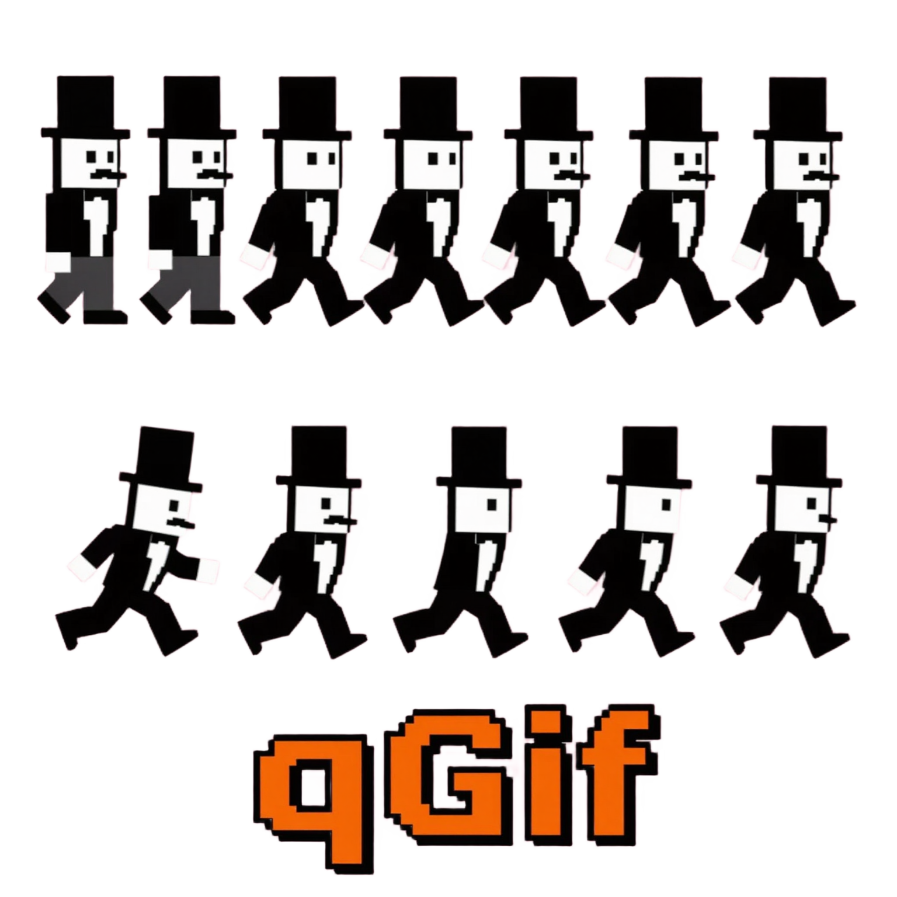

<p align="center">
  
</p>

# qGif

A small desktop app that opens an animated GIF, shows **all frames at once** in a
scrollable thumbnail grid, and exports the selected frames as fully composited
PNG files. No playback — just pick frames and save them.

## Features

- Scrollable, wrapping thumbnail grid of every frame (virtualised, handles 500+ frames).
- Single click = view (+ Save exports the viewed frame), double click = select, Shift+click = range; Select All / None / Invert (header + menus + shortcuts).
- Hover tooltips on every header/about icon.
- Large pixel-crisp preview of the last clicked frame.
- Export selected frames (or the viewed frame) as RGBA PNGs: `<name>_frame_0001.png`, … Frames are coalesced, so every PNG is the complete picture, never a partial GIF delta.
- Nord dark theme, layout and icon style shared with [goKomfy](https://github.com/mamorett/goKomfy); light mode follows the system default. Single binary per OS.

## Usage

```sh
qgif file.gif        # or open via the toolbar / Ctrl(Cmd)+O / drag & drop
```

1. Open a GIF (dialog, drag & drop, or `qgif file.gif`).
2. **Single-click** a frame to view it in the preview — Save then exports that frame.
3. **Double-click** frames to select them — Save then exports the selection. **Shift+click** drags a range.
4. Toolbar/menu icons show a tooltip on hover.
5. **Clean** (trash icon or Ctrl/⌘+Shift+W) unloads the GIF and returns to the drop zone.
6. **Save/Export** (Ctrl/⌘+E) → pick a folder via the system dialog (opens at the GIF's own folder) → PNGs land there.

Shortcuts: `⌘/Ctrl+O` open, `⌘/Ctrl+Shift+W` unload, `⌘/Ctrl+E` export to GIF folder, `⌘/Ctrl+Shift+E` export to another folder, `⌘/Ctrl+A` all, `⌘/Ctrl+Shift+A` none, `⌘/Ctrl+I` invert.

## Building

Requires Go ≥ 1.23 and a C toolchain (Fyne uses OpenGL/GLFW through cgo).

| OS | Prerequisites |
| --- | --- |
| Debian/Ubuntu/KDE neon | `sudo apt install golang gcc libgl1-mesa-dev xorg-dev` (Wayland tag: also `libwayland-dev libxkbcommon-dev wayland-protocols`) |
| Fedora | `sudo dnf install golang gcc libXcursor-devel libXrandr-devel mesa-libGL-devel libXi-devel libXinerama-devel libXxf86vm-devel` |
| Arch | `sudo pacman -S go gcc libxcursor libxrandr libxinerama libxi mesa` |
| macOS | Xcode Command Line Tools + Go |
| Windows | Go + MSYS2 `mingw-w64-x86_64-gcc` (native builds only) |

```sh
make          # build → build/qgif (macOS: .app bundle via `fyne package`)
make test     # go test ./...
make install  # Linux: ~/bin/qgif + icons + .desktop entry
make clean
```

### Cross-compiling (Linux host, Docker or Podman)

```sh
fyne-cross linux -arch=amd64,arm64 -app-id io.github.qgif.qgif
fyne-cross windows -arch=amd64,arm64 -app-id io.github.qgif.qgif
```

Linux → Windows and Linux → Linux-arm64 work out of the box. **Linux → macOS
requires the macOS SDK**, which Apple's licence only permits on Apple hardware —
use the free GitHub Actions `macos-latest` runner instead (CI builds it natively).

Without Docker, Windows builds also work with the mingw-w64 cross gcc:

```sh
CGO_ENABLED=1 GOOS=windows GOARCH=amd64 CC=x86_64-w64-mingw32-gcc \
  go build -ldflags="-H=windowsgui -s -w" -o qgif.exe .
```

### CI

`.github/workflows/build.yml` runs tests and `fyne package --release` on
ubuntu/windows/macOS runners and, on `v*` tags, attaches all three artifacts to a
GitHub release. That covers macOS without owning a Mac.

## Platform notes

- **Linux / KDE**: the default build uses X11 and runs on Plasma Wayland through XWayland; build with `-tags wayland` for native Wayland. Needs OpenGL at runtime. `fyne package -os linux` produces a `.tar.xz` with binary, `.desktop` file (includes `MimeType=image/gif;`) and icon, plus a Makefile for `make user-install`.
- **macOS**: `fyne package -os darwin` creates `qGif.app` with a native menu bar. Unsigned builds need right-click → Open the first time. Code signing/notarisation are out of scope for v1.
- **Windows**: `fyne package -os windows` embeds the icon and builds a console-less GUI exe. Ship as a ZIP.

## Known limitations

- The app uses Go's `image/gif`, which rejects some broken files (truncated files, or frames larger than the logical screen). Those show `Cannot decode GIF: <error>` and the app stays usable.
- GIFs whose decoded frames would exceed 2 GiB in RAM are refused with a clear message; there is no disk cache.
- Fyne draws its own widgets with OpenGL: on KDE you get Fyne's look (not Breeze) and Fyne's file dialogs (not the KDE ones).
- On macOS, files opened from Finder arrive only when launched with a path; use the Open dialog or drag & drop onto the window.

## Development

```text
internal/gifdec     GIF decoding + coalescing (pure Go)
internal/selection  selection state (pure Go)
internal/thumbs     thumbnail scaling (pure Go)
internal/export     atomic PNG export (pure Go)
internal/ui         Fyne widgets: window, frame cards, preview
```

The four core packages never import Fyne, so they are unit-tested without a
display. See `PLAN.md` for the authoritative design and `DECISIONS.md` for
deviations and gap-fills.
